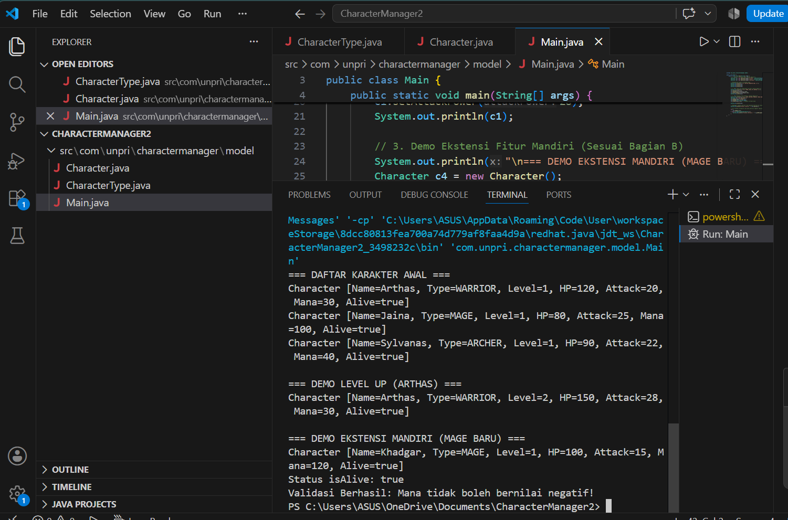
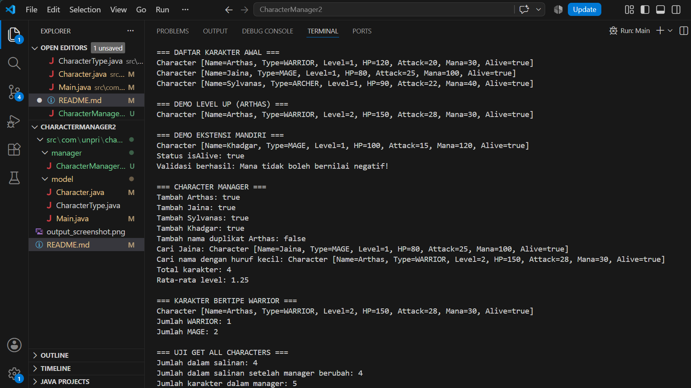
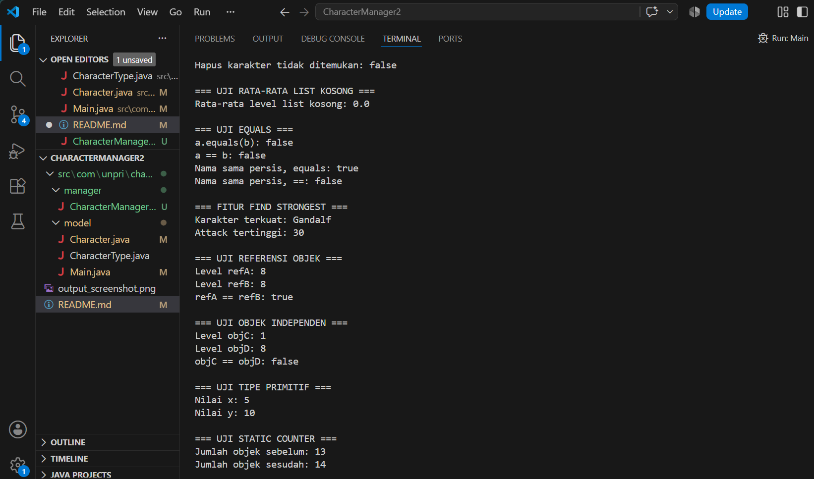

# Character Manager — TP3 (Java Visual SIH-6406)
## Deskripsi Singkat
Proyek ini membangun fondasi model *class* berorientasi objek untuk aplikasi **Character Manager** sebagai persiapan sprint GUI berikutnya. Di dalamnya, kami menerapkan enkapsulasi atribut, penggunaan Enum, *overloaded constructors*, serta ekstensi fitur mandiri berupa pengelolaan atribut `mana` dan validasi status kehidupan karakter.

### 🖥️ Screenshot Output Terminal

#### 📁 Struktur Folder Project
CharacterManager/
├── src/
│   └── com/
│       └── unpri/
│           └── charactermanager/
│               └── model/
│                   ├── Character.java
│                   ├── CharacterType.java
│                   └── Main.java
├── output_screenshot.png
└── README.md
## 👤 Identitas Pengembang
* Nama Lengkap: Inggrid Kesia Timoty Siahaan
* NIM:[253303621256]
* Kelas: 3 pagi b
* Link Google Docs (https://docs.google.com/document/d/11_jLyfLRsdpg9jiduk0TAVY9tez-n1Ho6KcA6v9v8Qo/edit?usp=sharing)

## TP5 — Character Manager

### 1. Fitur yang Diimplementasikan

Pada TP5, program Character Manager dikembangkan untuk mengelola data karakter menggunakan Java dan konsep Object-Oriented Programming (OOP). Fitur yang telah diimplementasikan meliputi:

- **Add Character:** Menambahkan karakter baru ke dalam daftar.
- **Find Character:** Mencari karakter berdasarkan nama.
- **Remove Character:** Menghapus karakter berdasarkan nama.
- **Duplicate Validation:** Menolak penambahan karakter dengan nama yang sudah terdaftar, tanpa membedakan huruf besar dan kecil.
- **Get Total Characters:** Menghitung jumlah karakter yang tersimpan.
- **Get Average Level:** Menghitung rata-rata level karakter dan mengembalikan `0.0` jika daftar kosong.
- **Find by Type:** Menampilkan karakter berdasarkan tipe, seperti `WARRIOR`, `MAGE`, dan `ARCHER`.
- **Get All Characters:** Mengembalikan salinan daftar karakter yang tidak dapat diubah secara langsung.
- **Character Equality:** Membandingkan dua objek `Character` berdasarkan nama melalui metode `equals()` dan `hashCode()`.

### 2. Bukti Pengujian CRUD

CRUD merupakan singkatan dari Create, Read, Update, dan Delete. Pengujian dilakukan melalui `Main.java`.

- **Create:** Menambahkan karakter Arthas, Jaina, Sylvanas, dan Khadgar.
- **Read:** Menampilkan karakter dan mencari karakter berdasarkan nama.
- **Update:** Memperbarui atribut level, hit points, dan attack power milik Arthas.
- **Delete:** Menghapus karakter Jaina dari daftar.

Pengujian tambahan dilakukan untuk memastikan nama duplikat ditolak dan jumlah karakter diperbarui setelah penghapusan.

**Screenshot hasil pengujian CRUD:**

Simpan screenshot output program pada folder `screenshots`, lalu tampilkan menggunakan Markdown berikut:

### 3. Eksperimen Reference dan Primitive

Eksperimen ini bertujuan untuk memahami perbedaan antara referensi objek dan tipe data primitif dalam Java.

Pada eksperimen referensi objek, variabel `refB` diisi dengan referensi dari `refA`. Ketika level diubah melalui `refB`, perubahan tersebut juga terlihat melalui `refA`, karena keduanya merujuk pada objek yang sama.

Pada eksperimen objek independen, dua objek dibuat secara terpisah. Perubahan level pada objek pertama tidak mengubah level objek kedua.

Pada eksperimen tipe data primitif, nilai variabel `x` disalin ke variabel `y`. Ketika nilai `y` diubah menjadi `10`, nilai `x` tetap `5`, karena keduanya menyimpan nilai secara terpisah.

**Screenshot eksperimen reference dan primitive:**

### 4. Fitur Tambahan Bagian C — Find Strongest

Fitur tambahan yang dikembangkan adalah `findStrongest()`, yaitu metode untuk mencari karakter dengan nilai `attackPower` tertinggi di dalam `CharacterManager`.

Metode ini memeriksa karakter dalam daftar dan membandingkan nilai attack power setiap karakter. Karakter dengan nilai tertinggi akan dikembalikan sebagai hasil. Jika daftar karakter kosong, metode mengembalikan `null`.

Fitur ini menggunakan konsep enkapsulasi karena data karakter diakses melalui getter `getAttackPower()`, bukan dengan mengakses atribut secara langsung.

Metode ini juga dilengkapi dokumentasi Javadoc yang menjelaskan fungsi, nilai kembalian, dan kondisi ketika daftar kosong.

### 5. Dokumentasi dan Analisis

Dokumentasi analisis TP5 mencakup penjelasan tentang referensi objek, perbedaan referensi dan tipe data primitif, penggunaan variabel `static`, implementasi `equals()`, serta risiko mengembalikan daftar internal secara langsung.

**Link Google Docs — Analisis TP5:**

[https://docs.google.com/document/d/13hSDwnIG8a7Ov0VOPC_eHdDZhg9jHwwUnOaimDDaGIk/edit?usp=sharing]

